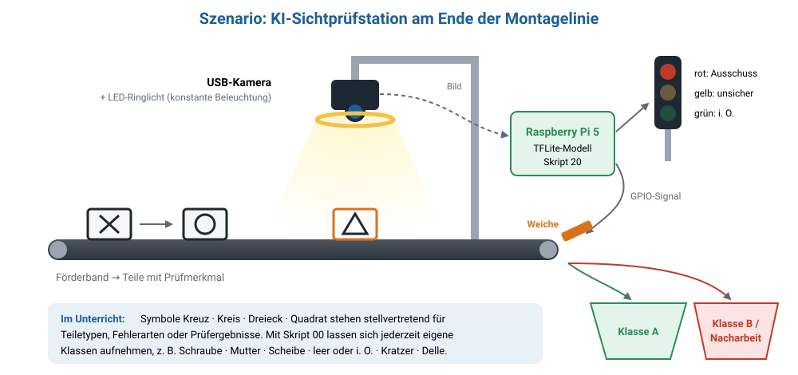

# Lernsituation „KI-Sichtprüfstation“ – Bildklassifikation mit dem Raspberry Pi

**Fachschule für Technik · Fach Künstliche Intelligenz · Umfang 8 – 10 Doppelstunden**

Die Lernenden entwickeln eine komplette KI-Pipeline – von der Datenaufnahme mit der Kamera über das Training verschiedener neuronaler Netze bis zur Live-Erkennung an einer Prüfstation. Alles läuft auf einem **Raspberry Pi 4 oder 5** mit USB-Kamera. Vier gezeichnete Symbole (Kreuz, Kreis, Dreieck, Quadrat) dienen als Stellvertreter für Teiletypen, Fehlerarten oder Prüfmarken; am Ende wird die Pipeline auf eine eigene industrielle Aufgabe übertragen.



## Handlungssituation

> Die *Mainfranken Präzisionsteile GmbH* (fiktiv) prüft am Ende einer Montagelinie bisher jedes Teil per Sichtkontrolle. Die Geschäftsleitung möchte prüfen lassen, ob eine **kostengünstige KI-Sichtprüfstation** auf Basis eines Raspberry Pi diese Aufgabe unterstützen kann. Ihr Team erhält den Auftrag, einen funktionsfähigen Prototyp zu entwickeln, seine Zuverlässigkeit zu bewerten und eine begründete Empfehlung für den Einsatz in der Fertigung abzugeben.

## Kompetenzen

Die Lernenden …
- erklären Grundbegriffe des maschinellen Lernens (überwachtes Lernen, Training, Validierung, Test, Inferenz),
- planen und erstellen einen ausgewogenen Bilddatensatz und bereiten ihn für das Training vor,
- beschreiben Aufbau und Funktionsweise von Neuron, FCNN, CNN und Transfer Learning und implementieren Kernbestandteile selbst,
- trainieren Modelle, deuten Lernkurven und verbessern Modelle gezielt (Augmentierung, Dropout, EarlyStopping, Hyperparameter),
- bewerten Modelle mit Konfusionsmatrix, Precision/Recall und Fehlerkosten und legen eine Konfidenzschwelle fest,
- setzen ein Modell auf dem Raspberry Pi ein (TFLite, Taktzeit, Signalausgabe, Protokoll) und
- übertragen die Lösung auf industrielle Prüfaufgaben und schätzen Grenzen und Risiken ein.

## Ablaufplan

| DS | Thema | Material | 🧪 Kontrolle |
|:--:|---|---|---|
| 1 | Szenario, KI-Grundbegriffe, Datensatz planen und **mit der Kamera aufnehmen** | `10` Teil A · `00_Datensatz_aufnehmen.py` | |
| 2 | Bild als Zahlenmatrix, Daten laden, normieren, aufteilen | `10` Teil B · `01_bild_als_zahlen.html` | TZK 1 |
| 3 | Neuron, Aktivierung, Softmax, One-Hot, erstes Keras-Modell | `10` Teil C · `02_neuron.html` · `03_softmax_verlust.html` | |
| 4 | Gradientenabstieg, Training, Test, Einzelbild-Vorhersage | `10` Teil D · `04_gradientenabstieg.html` | |
| 5 | FCNN systematisch: Augmentierung, Dropout, EarlyStopping, Experimente in Gruppen | `11` · `05_lernkurven.html` | TZK 2 |
| 6 | Faltung und Pooling selbst programmieren, CNN aufbauen | `12` Teil A · `06_faltung.html` | |
| 7 | CNN trainieren und bewerten, Fehlerkosten, Konfidenzschwelle, Export | `12` Teil B · `07_bewertung.html` | TZK 3 |
| 8 | Transfer Learning mit MobileNetV2, Grad-CAM, Modellvergleich | `13` | |
| 9 | Live-Erkennung, Taktzeit, Ampel (GPIO), Prüfprotokoll | `20` Teil A · `20_Symbolerkennung_live.py` | TZK 4 |
| 10 | Projekt: eigene Klassen aus der Fertigung – aufnehmen, trainieren, einsetzen, präsentieren | `20` Teil B | Projekt |

Bei 8 Doppelstunden: DS 3 + 4 zusammenfassen (Interaktivseiten als Hausaufgabe) und das Projekt in DS 10 als Ausblick behandeln.

## Dateien

```
datasets/symbols/
├── README.md                               ← diese Übersicht
├── 00_Datensatz_aufnehmen.py               ← Bilder mit der Kamera aufnehmen (beliebige Klassen)
├── 10_Bilddaten_und_erstes_Netz.ipynb      ← DS 1–4
├── 11_Vollvernetztes_Netz_FCNN.ipynb       ← DS 5
├── 12_Faltungsnetz_CNN.ipynb               ← DS 6–7
├── 13_Transfer_Learning_MobileNet.ipynb    ← DS 8
├── 20_Symbolerkennung_live.ipynb           ← DS 9–10
├── 20_Symbolerkennung_live.py              ← Prüfstation im Dauerbetrieb
├── ki_hilfen.py                            ← gemeinsame Hilfsfunktionen (Laden, Diagramme, Kamera, Export …)
├── requirements.txt
├── loesungen/                              ← Lösungsversionen der Notebooks (für Lehrkräfte)
├── material/
│   ├── 01_bild_als_zahlen.html … 07_bewertung.html   ← interaktive Grundlagen
│   ├── tzk1_… tzk4_….html                            ← interaktive Teilzielkontrollen
│   ├── bilder/                                       ← Grafiken für die Notebooks
│   └── quelle/                                       ← Skripte für Lehrkräfte (s. u.)
└── dataset, dataset1 … dataset6                     ← Bilddaten: <datensatz>/<klasse>/<bild>.png + klassen.txt
```

Zur Laufzeit entstehen außerdem `modelle/` (gespeicherte Modelle), `.cache/` (Zwischenspeicher der Bilddaten) und `protokoll/` (Prüfprotokolle). Diese Ordner sind von Git ausgenommen.

### Aufgabentypen in den Notebooks

| Symbol | Bedeutung |
|:--:|---|
| 📖 | Grundlagen in Markdown oder als eingebettete interaktive HTML-Seite |
| ✏️ | Code selbst schreiben (`# TODO`) – mit automatischer Rückmeldung ✅/❌ |
| 🔍 | Experiment oder Beobachtungsauftrag |
| 🧪 | Teilzielkontrolle (interaktiv, mit Ergebniscode für die Lehrkraft) |
| 🏭 | Bezug zur industriellen Fertigung |
| 🍓 | Hinweis für den Raspberry Pi |

Die **interaktiven Seiten** werden mit `kh.zeige_html("…")` direkt im Notebook angezeigt (JupyterLab, Jupyter Notebook und VS Code). Sie funktionieren ohne Internet und lassen sich auch einzeln im Browser öffnen.

## Datenstruktur und eigene Klassen

Jeder Datensatz hat einen Unterordner je Klasse und eine Datei `klassen.txt`:

```
dataset_neu/
  klassen.txt      0;Kreuz
                   1;Kreis
                   2;Dreieck
                   3;Quadrat
  0/ 1/ 2/ 3/      Bilder der jeweiligen Klasse
```

Neue Datensätze mit beliebigen Klassen:

```bash
python3 00_Datensatz_aufnehmen.py --datensatz teile --klassen Schraube Mutter Scheibe Leer
python3 00_Datensatz_aufnehmen.py --datensatz oberflaeche --klassen "i.O." Kratzer Delle --aufloesung 1920x1080
python3 00_Datensatz_aufnehmen.py --datensatz teile          # vorhandenen Datensatz fortsetzen
```

Tasten: `0`–`9` Bild in Klasse speichern · `n`/`p` + Leertaste für mehr als 10 Klassen · `s` Serienaufnahme · `z` rückgängig · `ESC` Ende.
Die Notebooks lesen Klassenzahl und -namen automatisch aus `klassen.txt` – es genügt, `DATENSATZ = ORDNER / "teile"` zu setzen.

| Datensatz | Kreuz | Kreis | Dreieck | Quadrat | Summe | Aufnahme |
|---|--:|--:|--:|--:|--:|---|
| dataset1 | 44 | 45 | 44 | 43 | 176 | 640 × 480 |
| dataset2 | 37 | 35 | 36 | 36 | 144 | 640 × 480 |
| dataset3 | 30 | 29 | 30 | 31 | 120 | 640 × 480 |
| dataset4 | 86 | 86 | 94 | 91 | 357 | 640 × 480 |
| dataset5 | 175 | 175 | 174 | 174 | 698 | überw. 1920 × 1080 |
| dataset6 | 60 | 60 | 60 | 60 | 240 | 1920 × 1080 |
| **dataset** (zusammengeführt) | 432 | 430 | 438 | 435 | 1735 | gemischt |

## Raspberry Pi einrichten

**Hardware:** Raspberry Pi 5 (4 oder 8 GB; Pi 4 mit 4 GB geht ebenfalls), aktive Kühlung, SD-Karte ≥ 32 GB, USB-Kamera (oder Kameramodul), optional 3 LEDs + 330-Ω-Widerstände.

```bash
cd ~/ml_project
python3 -m venv --system-site-packages .venv   # system-site-packages: gpiozero und picamera2 aus Raspberry Pi OS nutzen
source .venv/bin/activate
pip install -r datasets/symbols/requirements.txt
python3 -m ipykernel install --user --name=ml_project_kernel
```

**Laufzeiten** – grobe Richtwerte für einen Raspberry Pi 5, bitte vor dem Unterricht einmal selbst durchlaufen lassen:

| Schritt | Richtwert | Tipp |
|---|---|---|
| großen Datensatz erstmals laden | 1 – 2 min | danach aus `.cache/` in Sekunden |
| FCNN (32 × 32 grau), Notebook 11 | 1 – 3 min | |
| CNN (96 × 96 RGB), Notebook 12 | 10 – 20 min | Pi 4: `GROESSE = 64` |
| Transfer Learning (128 × 128, α = 0,35) | 2 – 5 min | Merkmale werden einmal vorab berechnet |
| Fine-Tuning (optional) | mehrere Minuten je Epoche | besser auf PC/GPU |

Weitere Tipps: Pro Pi nur **ein** Notebook mit TensorFlow gleichzeitig geöffnet lassen (RAM). Am Notebook-Ende gibt `kh.ram_aufraeumen()` Speicher frei. Die vortrainierten MobileNetV2-Gewichte werden beim ersten Start aus dem Internet geladen und in `~/.keras/models` abgelegt – ohne Internet vorher dorthin kopieren.

## Übertrag in die industrielle Fertigung

Die Pipeline bleibt gleich, es ändern sich nur Klassen und Bilder. Beispiele (ausführlich in Notebook 20, Teil B):

| Anwendung | Klassen |
|---|---|
| Teilesortierung / Variantenkontrolle | Schraube M6 · Schraube M8 · Mutter · Scheibe · leer |
| Oberflächenprüfung | i. O. · Kratzer · Delle · Verschmutzung |
| Vollständigkeitsprüfung | vollständig · Bauteil fehlt · falsches Bauteil |
| Lageerkennung für die Roboter-Zuführung | richtig · gedreht · auf der Seite |
| Werkzeugzustand | neu · verschlissen · gebrochen |
| Prüfmarken (wie die Symbole) | i. O. · Nacharbeit · Sperre |

Im Unterricht werden dabei auch typische Praxisthemen behandelt: konstante Beleuchtung und fester Kameraaufbau, Klasse „leer“, Konfidenzschwelle mit Rückweisung an den Menschen, Fehlerkosten (Schlupf vs. Pseudoausschuss), Taktzeit, Anbindung an die SPS statt direkter Aktoransteuerung, Protokollierung und Datendrift.

## Hinweise für Lehrkräfte

- **Lösungen:** `loesungen/` enthält alle Notebooks mit Lösungen. Die Schülerversionen im Hauptordner werden daraus erzeugt:
  ```bash
  python3 material/quelle/schuelerversion_erstellen.py
  ```
  Code zwischen `# >>> LOESUNG` und `# <<< LOESUNG` wird entfernt; Zeilen mit `# | ` werden zum Platzhalter. Vor der Weitergabe an Lernende den Ordner `loesungen/` entfernen.
- **Teilzielkontrollen anpassen:** Fragen stehen in `material/quelle/teilzielkontrollen_erstellen.py`; nach dem Bearbeiten das Skript ausführen. Typen: Einfach-/Mehrfachauswahl, Zahl mit Toleranz, Zuordnung, Reihenfolge. Am Ende erzeugt jede Kontrolle einen Ergebniscode (Name, Punkte, nicht gelöste Fragen) zum Einsammeln.
- **Differenzierung:** ⭐-Zusatzaufgaben (z. B. Fine-Tuning), Experimente in Notebook 11 arbeitsteilig in Gruppen, im Projekt freie Wahl der Anwendung.
- Das Notebook `00 data-info.ipynb` und die Ordner `deprecated/` und `misc/` gehören nicht zur Lernsituation.
