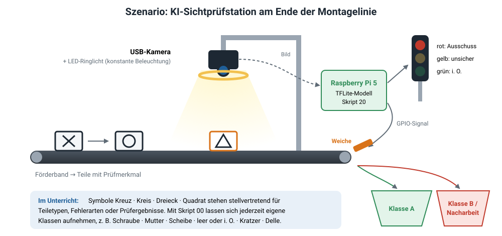

# Lernsituation „KI-Sichtprüfstation“ – Bildklassifikation mit dem Raspberry Pi

**Fachschule für Technik · Fach Künstliche Intelligenz · Umfang 8 – 10 Doppelstunden**

Die Lernenden entwickeln eine komplette KI-Pipeline – von der Datenaufnahme mit der Kamera über das Training verschiedener neuronaler Netze bis zur Live-Erkennung an einer Prüfstation. Alles läuft auf einem **Raspberry Pi 4 oder 5** mit USB-Kamera. Vier gezeichnete Symbole (Kreuz, Kreis, Dreieck, Quadrat) dienen als Stellvertreter für Teiletypen, Fehlerarten oder Prüfmarken; am Ende wird die Pipeline auf eine eigene industrielle Aufgabe übertragen.



## Handlungssituation

> Die *Mainfranken Präzisionsteile GmbH* (fiktiv) prüft am Ende einer Montagelinie bisher jedes Teil per Sichtkontrolle. Die Geschäftsleitung möchte prüfen lassen, ob eine **kostengünstige KI-Sichtprüfstation** auf Basis eines Raspberry Pi diese Aufgabe unterstützen kann. Ihr Team erhält den Auftrag, einen funktionsfähigen Prototyp zu entwickeln, seine Zuverlässigkeit zu bewerten und eine begründete Empfehlung für den Einsatz in der Fertigung abzugeben.

## Kompetenzen

Die Lernenden …
- erklären Grundbegriffe des maschinellen Lernens (überwachtes Lernen, Training, Validierung, Test, Inferenz),
- planen und erstellen einen ausgewogenen Bilddatensatz und bereiten ihn für das Training vor,
- beschreiben Aufbau und Funktionsweise von Neuron, FCNN, CNN und Transfer Learning und implementieren Kernbestandteile selbst,
- trainieren Modelle, deuten Lernkurven und verbessern Modelle gezielt (Augmentierung, Dropout, EarlyStopping, Hyperparameter),
- bewerten Modelle mit Konfusionsmatrix, Precision/Recall und Fehlerkosten und legen eine Konfidenzschwelle fest,
- setzen ein Modell auf dem Raspberry Pi ein (TFLite, Taktzeit, Signalausgabe, Protokoll) und
- übertragen die Lösung auf industrielle Prüfaufgaben und schätzen Grenzen und Risiken ein.

## Ablaufplan

| DS | Thema | Material | Kontrolle |
|:--:|---|---|---|
| 1 | Szenario (interaktives Förderband), KI-Grundbegriffe, Datensatz **mit der Kamera aufnehmen** | `10` Teil A · `00_szenario_pruefstation.html` · `00_Datensatz_aufnehmen.py` | |
| 2 | Bild als Zahlenmatrix, Matrix → Vektor, Daten laden, normieren, aufteilen | `10` Teil B · `01_bild_als_zahlen.html` · `01b_matrix_zu_vektor.html` | TZK 1 |
| 3 | Neuron, Aktivierung, Softmax, One-Hot, erstes Keras-Modell | `10` Teil C · `02_neuron.html` · `03_softmax_verlust.html` | |
| 4 | Gradientenabstieg, Training, Test, Einzelbild-Vorhersage | `10` Teil D · `04_gradientenabstieg.html` | |
| 5 | FCNN small/medium/big vergleichen: Augmentierung, Lernraten-Abnahme, EarlyStopping | `11` · `05_lernkurven.html` | TZK 2 |
| 6 | Faltung und Pooling selbst programmieren, CNN aufbauen | `12` Teil A · `06_faltung.html` | |
| 7 | CNN trainieren, Merkmalskarten deuten, bewerten, Konfidenzschwelle, Export | `12` Teil B · `07_bewertung.html` | TZK 3 |
| 8 | Transfer Learning mit MobileNetV2, Grad-CAM, Modellvergleich | `13` | |
| 9 | Live-Erkennung, Taktzeit, Ampel (GPIO), Prüfprotokoll | `20` Teil A · `20_Symbolerkennung_live.py` | TZK 4 |
| 10 | Projekt: eigene Klassen aus der Fertigung – aufnehmen, trainieren, einsetzen, präsentieren | `20` Teil B | Projekt |

Bei 8 Doppelstunden: DS 3 + 4 zusammenfassen (Interaktivseiten als Hausaufgabe) und das Projekt in DS 10 als Ausblick behandeln.

## Dateien

```
datasets/symbols/
├── README.md                               ← diese Übersicht
├── 00_Datensatz_aufnehmen.py               ← Bilder mit der Kamera aufnehmen (beliebige Klassen)
├── 10_Bilddaten_und_erstes_Netz_gruen.ipynb ← DS 1–4, Niveau grün (Code fertig, Verständnisfragen)
├── 10_Bilddaten_und_erstes_Netz_gelb.ipynb  ← DS 1–4, Niveau gelb (Pseudocode → Python)
├── 10_Bilddaten_und_erstes_Netz_rot.ipynb   ← DS 1–4, Niveau rot (Code selbst schreiben)
├── 11_Vollvernetztes_Netz_FCNN.ipynb       ← DS 5
├── 12_Faltungsnetz_CNN.ipynb               ← DS 6–7
├── 13_Transfer_Learning_MobileNet.ipynb    ← DS 8
├── 20_Symbolerkennung_live.ipynb           ← DS 9–10
├── 20_Symbolerkennung_live.py              ← Prüfstation im Dauerbetrieb
├── ki_hilfen.py                            ← gemeinsame Hilfsfunktionen (Laden, Diagramme, Kamera, Export …)
├── requirements.txt
├── loesungen/                              ← Quell- und Lösungsversionen der Notebooks (für Lehrkräfte)
├── material/
│   ├── 00_szenario_pruefstation.html … 07_bewertung.html ← interaktive Grundlagen
│   ├── tzk1_… tzk4_….html                            ← interaktive Teilzielkontrollen
│   ├── bilder/                                       ← Grafiken für die Notebooks
│   └── quelle/                                       ← Skripte für Lehrkräfte (s. u.)
└── dataset, dataset1 … dataset6                     ← Bilddaten: <datensatz>/<klasse>/<bild>.png + klassen.txt
```

Zur Laufzeit entstehen außerdem `modelle/` (gespeicherte Modelle), `.cache/` (Zwischenspeicher der Bilddaten) und `protokoll/` (Prüfprotokolle). Diese Ordner sind von Git ausgenommen.

### Drei Niveaus in Notebook 10

Ganz oben in jedem Notebook 10 steht eine farbige **Auswahlleiste**. Ein Klick öffnet die Version mit einem anderen Niveau:

| Niveau | Datei | Was die Lernenden tun |
|---|---|---|
| **grün** – Einsteiger | `10_…_gruen.ipynb` | Der gesamte Code ist fertig und ausführbar. Sie führen aus, beobachten und beantworten Verständnisfragen. |
| **gelb** – Aufbau | `10_…_gelb.ipynb` | Pseudocode in einfacher Sprache steht in den Zellen, die nötigen Befehle stehen darüber. Die Lernenden übersetzen jede Zeile in Python. |
| **rot** – Profi | `10_…_rot.ipynb` | Code selbst schreiben, nur kurze Hinweise (wie die übrigen Notebooks). |

Alle drei Versionen haben dieselben Erklärungen in einfacher Sprache und dieselben Kontrollen. Hinweis: Die grüne Version enthält die vollständigen Lösungen der gelben und roten Aufgaben.

### Kennzeichen in den Notebooks

| Kennzeichen | Bedeutung |
|---|---|
| **[Lesen]** | Grundlagen in Markdown oder als eingebettete interaktive Seite |
| **[Aufgabe]** | Code ausführen, ergänzen oder selbst schreiben – mit farbiger Rückmeldung „Richtig“ / „Noch nicht richtig“ |
| **[Frage]** | Verständnisfrage – schriftlich in der Antwortzelle oder im Gespräch |
| **[Test]** | Teilzielkontrolle (interaktiv, sofortige Rückmeldung) |
| **[Industrie]** | Bezug zur industriellen Fertigung |
| **[Raspberry Pi]** | Hinweis für den Raspberry Pi |

Die Notebooks verwenden bewusst **keine Emojis**: Raspberry Pi OS bringt keine Emoji-Schrift mit, sie würden als Kästchen erscheinen. Die Lernenden werden durchgehend mit **Sie** angesprochen.

Die **interaktiven Seiten** werden mit `kh.zeige_html("…")` direkt im Notebook angezeigt (JupyterLab, Jupyter Notebook und VS Code). Ihre Höhe passt sich automatisch an den Inhalt an, sodass keine zusätzliche Scrollleiste entsteht. Sie funktionieren ohne Internet und lassen sich auch einzeln im Browser öffnen.

### Modelle

Die Netze entsprechen den ursprünglichen Notebooks 02, 02a, 02b und 02c:

| Notebook | Modell | Training |
|---|---|---|
| 10 | FCNN „small“ aus 02: Flatten → 32 → 128 → 64 → 16 (je Dropout 0,2) → Softmax, 32 × 32 grau | Adam 1e-4, Batch 8, 150 Epochen |
| 11 | FCNN „small“ / **„medium“** / „big“ aus 02a, 32 × 32 grau, Augmentierung Flip/Rotation 0,1/Zoom 0,05 | Adam 3e-4 mit ExponentialDecay (500, 0,9), Batch 32, bis 500 Epochen, EarlyStopping 50 |
| 12 | CNN „small“ aus 02b: Rescaling → Conv 16/32/64/128/16 (je MaxPooling) → Flatten → 256 → 32 (Dropout 0,3) → Softmax, 224 × 224 RGB | Adam 3e-4, Batch 32, bis 300 Epochen, EarlyStopping 20 |
| 13 | MobileNetV2 (ImageNet, eingefroren) aus 02c, 224 × 224 RGB, Kopf GlobalAveragePooling → Dropout 0,2 → Softmax, Augmentierung Flip/Rotation 0,2 | Adam 1e-3 mit ExponentialDecay (500, 0,96), 10 Epochen; optional Fine-Tuning ab Schicht 100 mit RMSprop |

Kleine technische Anpassungen ohne Einfluss auf die Rechnung: `Lambda(rgb_to_grayscale)` ist durch Laden als Graustufenbild ersetzt (gleiche Gewichtung 0,299/0,587/0,114, aber speicher- und TFLite-tauglich), `preprocess_input` durch die gleichwertige Schicht `Rescaling(1/127.5, offset=-1)`, die Augmentierung läuft in der Datenpipeline statt im Modell, und die Bilder werden im Speicher statt über `splitfolders` aufgeteilt.

### Farbreihenfolge (BGR/RGB) – geprüft

| Stelle | Ergebnis |
|---|---|
| Aufnahme (`00`), OpenCV und Picamera2 (`RGB888` liefert B, G, R) | Bilder werden korrekt als PNG gespeichert |
| Laden für das Training (`kh.lade_datensatz`) und Inferenz (`kh.Klassifikator`) | beide nutzen `kh.bild_vorbereiten()` → identische Umwandlung BGR → RGB bzw. → Grau |
| Anzeige, Grad-CAM, Live-Bild, Ampelfarben | überall explizit umgewandelt bzw. BGR-Farbwerte |
| vorhandene Datensätze | natürliche Farben (gelbes Objekt erscheint gelb) |

`kh.farbtest()` prüft die Kette automatisch mit einem roten Testbild. Einziger Fund in den Originalen: In 02a wurde beim Einzelbild-Test durch 255 geteilt, obwohl das FCNN mit Werten 0 … 255 trainiert wurde. In der neuen Pipeline bekommen Training und Inferenz immer dieselben Werte.

## Datenstruktur und eigene Klassen

Jeder Datensatz hat einen Unterordner je Klasse und eine Datei `klassen.txt`:

```
dataset_neu/
  klassen.txt      0;Kreuz
                   1;Kreis
                   2;Dreieck
                   3;Quadrat
  0/ 1/ 2/ 3/      Bilder der jeweiligen Klasse
```

Neue Datensätze mit beliebigen Klassen:

```bash
python3 00_Datensatz_aufnehmen.py --datensatz teile --klassen Schraube Mutter Scheibe Leer
python3 00_Datensatz_aufnehmen.py --datensatz oberflaeche --klassen "i.O." Kratzer Delle --aufloesung 1920x1080
python3 00_Datensatz_aufnehmen.py --datensatz teile          # vorhandenen Datensatz fortsetzen
```

Tasten: `0`–`9` Bild in Klasse speichern · `n`/`p` + Leertaste für mehr als 10 Klassen · `s` Serienaufnahme · `z` rückgängig · `ESC` Ende.
Die Notebooks lesen Klassenzahl und -namen automatisch aus `klassen.txt` – es genügt, `DATENSATZ = ORDNER / "teile"` zu setzen.

| Datensatz | Kreuz | Kreis | Dreieck | Quadrat | Summe | Aufnahme |
|---|--:|--:|--:|--:|--:|---|
| dataset1 | 44 | 45 | 44 | 43 | 176 | 640 × 480 |
| dataset2 | 37 | 35 | 36 | 36 | 144 | 640 × 480 |
| dataset3 | 30 | 29 | 30 | 31 | 120 | 640 × 480 |
| dataset4 | 86 | 86 | 94 | 91 | 357 | 640 × 480 |
| dataset5 | 175 | 175 | 174 | 174 | 698 | überw. 1920 × 1080 |
| dataset6 | 60 | 60 | 60 | 60 | 240 | 1920 × 1080 |
| **dataset** (zusammengeführt) | 432 | 430 | 438 | 435 | 1735 | gemischt |

## Raspberry Pi einrichten

**Hardware:** Raspberry Pi 5 (4 oder 8 GB; Pi 4 mit 4 GB geht ebenfalls), aktive Kühlung, SD-Karte ≥ 32 GB, USB-Kamera (oder Kameramodul), optional 3 LEDs + 330-Ω-Widerstände.

```bash
cd ~/ml_project
python3 -m venv --system-site-packages .venv   # system-site-packages: gpiozero und picamera2 aus Raspberry Pi OS nutzen
source .venv/bin/activate
pip install -r datasets/symbols/requirements.txt
python3 -m ipykernel install --user --name=ml_project_kernel
```

**Laufzeiten** – grobe Schätzungen für einen Raspberry Pi 5 (nicht gemessen), bitte vor dem Unterricht einmal selbst durchlaufen lassen:

| Schritt | Schätzung | Tipp |
|---|---|---|
| großen Datensatz erstmals laden | 1 – 2 min | danach aus `.cache/` in Sekunden |
| Notebook 10 (dataset1, 150 Epochen) | ca. 1 min | |
| FCNN, Notebook 11 (je Variante) | 2 – 5 min | |
| CNN 224 × 224, Notebook 12 | ca. 1 min pro Epoche | Pi 4 oder wenig Zeit: `GROESSE = 128` |
| MobileNetV2 224 × 224, Notebook 13 | 1 – 2 min pro Epoche | Fine-Tuning nur mit Zeitpuffer |

Weitere Tipps: Pro Pi nur **ein** Notebook mit TensorFlow gleichzeitig geöffnet lassen (RAM). Am Notebook-Ende gibt `kh.ram_aufraeumen()` Speicher frei. Die vortrainierten MobileNetV2-Gewichte werden beim ersten Start aus dem Internet geladen und in `~/.keras/models` abgelegt – ohne Internet vorher dorthin kopieren.

## Übertrag in die industrielle Fertigung

Die Pipeline bleibt gleich, es ändern sich nur Klassen und Bilder. Beispiele (ausführlich in Notebook 20, Teil B):

| Anwendung | Klassen |
|---|---|
| Teilesortierung / Variantenkontrolle | Schraube M6 · Schraube M8 · Mutter · Scheibe · leer |
| Oberflächenprüfung | i. O. · Kratzer · Delle · Verschmutzung |
| Vollständigkeitsprüfung | vollständig · Bauteil fehlt · falsches Bauteil |
| Lageerkennung für die Roboter-Zuführung | richtig · gedreht · auf der Seite |
| Werkzeugzustand | neu · verschlissen · gebrochen |
| Prüfmarken (wie die Symbole) | i. O. · Nacharbeit · Sperre |

Im Unterricht werden dabei auch typische Praxisthemen behandelt: konstante Beleuchtung und fester Kameraaufbau, Klasse „leer“, Konfidenzschwelle mit Rückweisung an den Menschen, Fehlerkosten (Schlupf vs. Pseudoausschuss), Taktzeit, Anbindung an die SPS statt direkter Aktoransteuerung, Protokollierung und Datendrift.

## Hinweise für Lehrkräfte

- **Quell- und Lösungsversionen:** `loesungen/` enthält alle Notebooks mit Lösungen. Die Versionen für die Lernenden im Hauptordner werden daraus erzeugt:
  ```bash
  python3 material/quelle/schuelerversion_erstellen.py
  ```
  In Code-Zellen ist der Code zwischen `# >>> LOESUNG` und `# <<< LOESUNG` die Lösung (Niveau grün), Zeilen mit `# GELB| ` sind der Pseudocode für gelb, Zeilen mit `# | ` der Platzhalter für rot. Markdown-Zellen mit dem Tag `niveau-gruen`, `niveau-gelb` oder `niveau-rot` erscheinen nur in diesem Niveau. Notebook 10 hat die Metadaten-Angabe `"niveaus": true` und wird deshalb dreifach erzeugt. Vor der Weitergabe an Lernende den Ordner `loesungen/` entfernen.
- **Teilzielkontrollen anpassen:** Fragen stehen in `material/quelle/teilzielkontrollen_erstellen.py`; nach dem Bearbeiten das Skript ausführen. Typen: Einfach-/Mehrfachauswahl, Zahl mit Toleranz, Zuordnung, Reihenfolge. Die Lernenden sehen sofort, ob ihre Antwort stimmt, und am Ende ihre Punktzahl – ohne Namensfeld und ohne Abgabe.
- **Differenzierung:** drei Niveaus in Notebook 10, Zusatzaufgaben (z. B. Fine-Tuning), Experimente in Notebook 11 arbeitsteilig in Gruppen, im Projekt freie Wahl der Anwendung.
- Das Notebook `00 data-info.ipynb` und die Ordner `deprecated/` und `misc/` gehören nicht zur Lernsituation.
